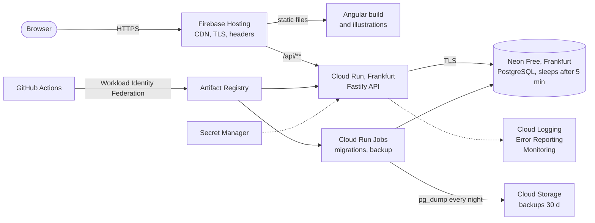

# Pre-launch review — 2026-10-22

Overall review of HIPMaster (architecture, code, design, content) before it goes live on Google Cloud, at the request
of the project owner. Method: reading the ADRs and the code, two detailed code reviews (API and front end), trying
the application at 375 × 812 px (home, catalogue, game against the bot, account, boosters), and a same-day survey of
Google Cloud prices.

Decisions taken by the project owner during the review: the game will be open **to colleagues by invitation** (the
site is reachable on the Internet, sign-up requires a code), and the GitHub repository **stays public**
([ADR 0022](../decisions/0022-depot-public.md)).

## Summary

HIPMaster is a complete and soundly built game: pure game logic, an authoritative server, OpenAPI contracts, and tests
and baseline accessibility checked continuously. But it was designed to run on a development machine: **it is not yet
deployable**, and two topics block the opening.

1. **Operations**: the API does not start as is on Cloud Run (listening address, port, Docker image), does not log its
   500 errors, keeps its database connections open, and keeps the games against the bot in memory, which would make
   them vanish at every deployment (US-046, US-052).
2. **Robustness and abuse**: no rate limiting, and a transient server failure can make a player lose their account
   (US-047, US-055).

The design works but looks like a prototype (greyscale, a home page without a card), and the game board does not fit
on a phone screen (EPIC-10).

Recommended hosting: **Firebase Hosting, Cloud Run and a free Neon PostgreSQL database, in Frankfurt, for about €0
per month** (ADR 0021), on a dedicated Google Cloud project under the project owner's personal account. Estimated
effort: about 7.5 estimation days (backlog scale) before a first launch, and 3.5 more days before sending the
invitations.

## What is solid

- **Game logic** is pure and the server is authoritative (ADR 0004, 0013): each player only receives their own view
  (`vueDe`), never the opponent's hand or draw pile.
- **Access control**: no flaw found that exposes another player's data (boosters, collection, duels); tokens and codes
  are stored as hashes, with no secret in URLs or logs.
- **Integrity of winnings**: booster openings and rewards run in a transaction with a row lock, a single reward per
  game (primary key), duels use optimistic concurrency (version and `If-Match`).
- **Duels and booster refill** with no in-memory state or background task: already compatible with several instances
  and with a CPU allocated only during requests.
- **Front end**: no HTML injection possible (neither `innerHTML` nor a bypass of sanitisation), a clean build
  (fingerprinted names, no published source maps, 104 KB transferred on first load), AVIF and WebP illustrations
  adapted to the screen, nothing overflows at 360 px.
- **Tooling**: quality gate (ESLint with SonarJS, Prettier, types, tests), Playwright journeys with an axe audit on
  mobile and desktop in both themes, Dependabot, ADRs and backlog kept up to date.

## Content and compliance

| Finding                                                                                                                                                                                                                                                                                                             | Severity  | Follow-up |
| ------------------------------------------------------------------------------------------------------------------------------------------------------------------------------------------------------------------------------------------------------------------------------------------------------------------- | --------- | --------- |
| The GitHub repository `Obemm/20_HIPMaster` is **public**, whereas ADR 0009 reasons "as long as the repository is private". It contains the card text (the company products and integration platform) and a summary of the the company ADR reference. The project owner accepts this choice: this information is public elsewhere. | Accepted  | ADR 0022  |
| No page says what data is kept (username, collection, IP addresses in the logs) or how to delete one's account.                                                                                                                                                                                                     | Important | US-053    |
| No instruction to search engines (`robots.txt`, `noindex`) for a site reserved for invited users.                                                                                                                                                                                                                   | Minor     | US-050    |

A public repository keeps GitHub Actions minutes free and unlimited, and makes SonarQube Cloud free: the gap with the company
[ref] noted by ADR 0009 can be closed (ADR 0022).

## Architecture and API

The overall architecture holds: monorepo, pure domain with no dependency, REST API with contracts written before the
code, PostgreSQL. Four gaps between the ADRs and reality:

- ADR 0006 announces a PWA that does not exist (US-063);
- ADR 0009 assumes a private repository, which is public: a choice accepted by the project owner (ADR 0022);
- ADR 0008 targets Azure: replaced by ADR 0021, accepted during the review;
- ADR 0014 (in-memory games, a single instance) is no longer tenable with continuous deployment: the games against the
  bot must join the duels in the database (US-052), with the same engine and the same persistence schema.

Findings of the API code review (checked in the code and in the libraries):

| Finding                                                                                                                                                                                    | Severity                        | Follow-up      |
| ------------------------------------------------------------------------------------------------------------------------------------------------------------------------------------------ | ------------------------------- | -------------- |
| Does not start on Cloud Run as is: listens on `127.0.0.1`, ignores `PORT`, no Docker image.                                                                                                | Blocking                        | US-046         |
| 500 errors are never logged: the custom error handler replaces Fastify's, the only one that logs.                                                                                          | Blocking                        | US-046         |
| No rate limiting or `trustProxy`: 1,000 anonymous games evict all games in progress; accounts and duels are unlimited.                                                                     | Blocking                        | US-047         |
| Games against the bot in memory: lost at every deployment, recycling or scale-to-zero; only one instance possible.                                                                         | Blocking before the invitations | US-052         |
| Without `DATABASE_URL`, a silent fallback to PGlite: in production, each instance would have its own ephemeral database.                                                                   | Important                       | US-046         |
| Eternal sessions; regenerating one's recovery code does not close the other sessions.                                                                                                      | Important                       | US-047, US-054 |
| Default postgres.js pool (10 connections per instance, never closed): the free database would never go to sleep; migrations at start-up without a lock; no graceful shutdown on `SIGTERM`. | Blocking                        | US-046, US-050 |
| pino logs without a `severity` field: everything arrives as "DEFAULT" in Cloud Logging, so no filter, no alert, no Error Reporting.                                                        | Important                       | US-046         |
| Tests never run on a real PostgreSQL: PGlite runs everything one query at a time, so the "simultaneous" tests prove nothing.                                                               | Important                       | US-056         |
| No secondary index; "My duels", polled by every client every 60 s, scans the table and rereads the full state of all the player's duels.                                                   | Important                       | US-057         |
| Nothing is ever deleted (sessions, abandoned accounts, expired challenges, finished duels).                                                                                                | Important                       | US-054         |
| Predictable duel randomness: mulberry32 generator (32-bit state), 31-bit seed, public decks and algorithm.                                                                                 | Nice to have                    | US-058         |
| Two simultaneous "random opponent" searches wait for each other; a double click can open two duels.                                                                                        | Nice to have                    | US-058         |
| A logged-in player's game against the bot can be played by anyone who knows its identifier; recovery-code hash without a secret.                                                           | Nice to have                    | US-047         |

## Front end

Findings of the front-end code review (checked on the production build, at 360 × 740 px):

| Finding                                                                                                                                                                                | Severity     | Follow-up      |
| -------------------------------------------------------------------------------------------------------------------------------------------------------------------------------------- | ------------ | -------------- |
| If `/api/v1/moi` fails other than with a 401 (transient failure, deployment, 429), the screen offers "Create an account", and the new account **overwrites the token** of the old one. | Blocking     | US-055         |
| The build inserts critical CSS and an inline script: with the planned CSP, the site would display without styles.                                                                      | Blocking     | US-050         |
| The home page shows players a developer message: "run it with `npm run dev`".                                                                                                          | Blocking     | US-055         |
| 401, 429 and network errors confused; screens stuck on "Loading…"; no "Retry"; if the catalogue is missing, opening a booster consumes it without showing a card.                      | Important    | US-055         |
| Game and duel identifiers pasted into API URLs without encoding: a booby-trapped link can make another route be called with the player's token.                                        | Important    | US-055         |
| Catalogue reloaded on every page, responses neither compressed nor cached, a single bundle for the 11 pages; illustrations without a fingerprint, under a prefix shared with a route.  | Nice to have | US-057         |
| No PWA, default Angular favicon, no preview (Open Graph) for challenge links.                                                                                                          | Nice to have | US-063, US-061 |
| Banner links 20 px tall, card text fixed at 10 px, page changes not announced to screen readers.                                                                                       | Nice to have | US-060, US-059 |
| Players' JavaScript errors never reported.                                                                                                                                             | Nice to have | US-051         |

## Design and ergonomics

Tried at 375 × 812 px, dark theme.

| Finding                                                                                                                                                                                               | Effect                                                     | Follow-up |
| ----------------------------------------------------------------------------------------------------------------------------------------------------------------------------------------------------- | ---------------------------------------------------------- | --------- |
| **Game board**: the "How to play?" help is expanded on opening and fills the first screen and a half; the bot's side starts at about 1,100 px, the player's hand at about 1,500 px (a 2,000 px page). | You have to keep scrolling to play: the heart of the game. | US-059    |
| **Navigation**: when logged in, the header lines up four small links and the username (which wraps onto two lines); "Play" and the catalogue are only reachable from the home page.                   | Sections hard to reach with a thumb.                       | US-060    |
| **Identity**: greyscale interface (the accent is the text colour), system font, no logo; the home page shows no card and says "Project under construction".                                           | The game looks like a prototype; little urge to enter it.  | US-061    |
| **Boosters**: a text and a button; on opening, the 5 cards appear all at once.                                                                                                                        | The high point of a collectible game goes unnoticed.       | US-062    |
| **PWA**: no manifest, no service worker, no icons, although ADR 0006 announces a PWA.                                                                                                                 | Cannot be installed on the phone's home screen.            | US-063    |

Positive points: the cards themselves (rarity frames, vector illustrations, legible cost, attack and HP), the
filterable catalogue, the automatic dark theme, no horizontal overflow at 375 px, and the clarity of the texts
("A username is all it takes: no password, no e-mail").

## Chosen hosting

Details and alternatives: [ADR 0021](../decisions/0021-hebergement-gcp.md) (accepted on 2026-10-22; replaces ADR
0008, which targeted Azure).

Prices and quotas surveyed on 2026-10-22, for a dedicated Google Cloud project on the project owner's personal
account:

| Item                                                              | Estimated monthly cost                                   |
| ----------------------------------------------------------------- | -------------------------------------------------------- |
| Neon Free (managed PostgreSQL, Frankfurt)                         | €0: 1 GB, 100 compute hours per month, no bank card      |
| Cloud Run (API, migrations, backup)                               | €0: 2 million requests and 180,000 vCPU-s free per month |
| Firebase Hosting                                                  | €0: 10 GB stored, 360 MB transferred per day             |
| Artifact Registry, Secret Manager, Cloud Logging, Cloud Scheduler | €0 within the free quotas                                |
| Cloud Storage (backups of a few MB) and egress traffic            | a few cents                                              |
| **Total**                                                         | **≈ €0 per month**                                       |

The condition for staying free: **let the database sleep when nobody is playing**. Neon does not go to sleep as long
as a connection stays open, and its quota (about 13 hours of activity per day) would be used up by an API that keeps
its connections, an availability check that queries the database, or a forgotten tab that polls the server every
minute. Stories US-046, US-051 and US-055 take care of this, and consumption is monitored with an alert.

If the game grows, Cloud SQL (≈ €10 to 12 per month, the first version of ADR 0021) takes over by changing only the
connection variable.

## Roadmap

Two epics: [EPIC-09](../backlog/epics/EPIC-09-mise-en-ligne-gcp.md) (going live) and
[EPIC-10](../backlog/epics/EPIC-10-identite-visuelle-mobile.md) (visual identity and mobile comfort). Estimates on
the backlog scale (S = ½ day, M = 1 day, L = 2 days).

| Batch                         | Stories, in order                                      | Estimate | Result                                                                                                        |
| ----------------------------- | ------------------------------------------------------ | -------- | ------------------------------------------------------------------------------------------------------------- |
| 1. Before the first launch    | US-046, US-056, US-047, US-048, US-055, US-049, US-050 | 7.5 days | The game runs on `hipmaster.web.app`, deployed on every merge, protected, by invitation; you play alone on it |
| 2. Before sending invitations | US-052, US-051, US-053, US-059, US-060                 | 3.5 days | Games that survive deployments, alerts, tested backups, privacy, a game comfortable on a phone                |
| 3. Afterwards                 | US-054, US-057, US-058, US-061, US-063, US-062         | 5 days   | Purged data, performance, fair duels, visual identity, PWA, staged booster opening                            |

Batch 1 can progress on two fronts without file conflicts: the API (US-046, then US-056) on one side, the front end
(US-055) on the other; infrastructure (US-049) touches no code. US-047 and US-048 touch the API and the account
screen: they come after.

## Project owner decisions

To be settled in batch 2: the **retention periods** (US-053, US-054). Proposal: 90 days for unused sessions, 12 months
for inactive accounts, 30 days for technical logs and backups. At the time of US-049, the project owner will also
authorise the `neonctl` CLI through a browser sign-in.

Settled on 2026-10-22:

- the repository stays public (ADR 0022);
- the €10-12 per month solution (Cloud SQL) is too expensive for a personal exercise: free target;
- ADR 0021 (Firebase Hosting, Cloud Run, Neon) is accepted and replaces ADR 0008; the Neon account is created;
- the infrastructure is created by a `gcloud` script that Claude runs (US-049), on a dedicated project of the personal
  account, which already has a billing account open; the workstation's professional `gcloud` configuration is never
  used.
