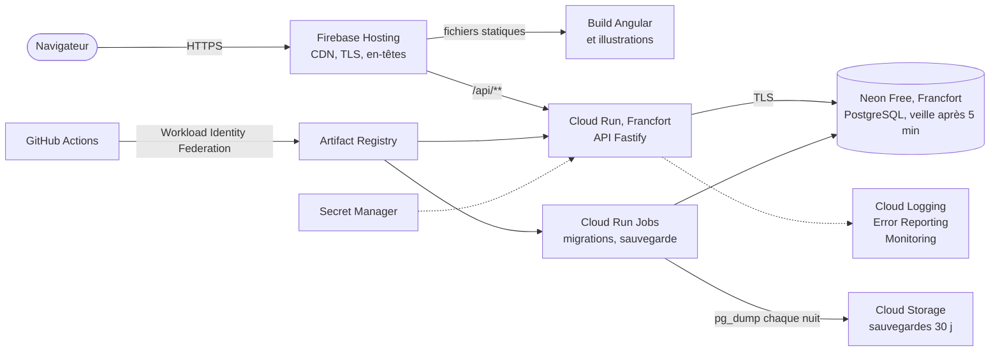

# Revue avant mise en ligne — 2026-10-22

Revue d'ensemble de HIPMaster (architecture, code, design, contenu) avant sa mise en ligne sur Google Cloud, à la
demande du porteur du projet. Méthode : lecture des ADR et du code, deux revues de code détaillées (API et front),
essai de l'application en 375 × 812 px (accueil, catalogue, partie contre le bot, compte, boosters), relevé des prix
Google Cloud le jour même.

Décisions du porteur du projet prises pendant la revue : le jeu sera ouvert **aux collègues sur invitation** (le
site est joignable sur Internet, l'inscription exige un code), et le dépôt GitHub **reste public**
([ADR 0022](../decisions/0022-depot-public.md)).

## Synthèse

HIPMaster est un jeu complet et sainement construit : logique de jeu pure, serveur qui fait foi, contrats OpenAPI,
tests et accessibilité de base vérifiés en continu. Mais il a été conçu pour tourner sur un poste de développement :
**il n'est pas encore déployable**, et deux sujets bloquent l'ouverture.

1. **Exploitation** : l'API ne démarre pas telle quelle sur Cloud Run (écoute, port, image Docker), ne journalise
   pas ses erreurs 500, garde ses connexions à la base ouvertes, et garde les parties contre le bot en mémoire, ce
   qui les ferait disparaître à chaque déploiement (US-046, US-052).
2. **Robustesse et abus** : aucune limitation de débit, et une panne passagère du serveur peut faire perdre son
   compte à un joueur (US-047, US-055).

Le design fonctionne mais ressemble à un prototype (niveaux de gris, accueil sans carte), et le plateau de partie ne
tient pas dans un écran de téléphone (EPIC-10).

Hébergement recommandé : **Firebase Hosting, Cloud Run et une base PostgreSQL Neon gratuite, à Francfort, pour
environ 0 € par mois** (ADR 0021), sur un projet Google Cloud dédié du compte personnel du porteur du projet. Effort estimé : environ 7,5 jours d'estimation (échelle du backlog) avant une première mise en ligne,
3,5 jours de plus avant d'envoyer les invitations.

## Ce qui est solide

- **Logique de jeu** pure et serveur qui fait foi (ADR 0004, 0013) : chaque joueur ne reçoit que sa vue (`vueDe`),
  jamais la main ni la pioche adverses.
- **Contrôle d'accès** : aucune faille d'accès aux données d'un autre joueur trouvée (boosters, collection, duels) ;
  jetons et codes stockés sous forme d'empreinte, aucun secret dans les URL ni dans les journaux.
- **Intégrité des gains** : ouvertures de boosters et récompenses en transaction avec verrou de ligne, une seule
  récompense par partie (clé primaire), duels en concurrence optimiste (version et `If-Match`).
- **Duels et recharge des boosters** sans état en mémoire ni tâche de fond : déjà compatibles avec plusieurs
  instances et avec un processeur alloué seulement pendant les requêtes.
- **Front** : aucune injection HTML possible (ni `innerHTML` ni contournement de l'assainissement), build propre
  (noms à empreinte, pas de source maps publiées, 104 Ko transférés au premier chargement), illustrations AVIF et
  WebP adaptées à l'écran, rien ne déborde à 360 px.
- **Outillage** : quality gate (ESLint avec SonarJS, Prettier, types, tests), parcours Playwright avec audit axe sur
  mobile et bureau dans les deux thèmes, Dependabot, ADR et backlog tenus à jour.

## Contenu et conformité

| Constat                                                                                                                                                                                                                                                                                                                          | Gravité   | Suite    |
| -------------------------------------------------------------------------------------------------------------------------------------------------------------------------------------------------------------------------------------------------------------------------------------------------------------------------------- | --------- | -------- |
| Le dépôt GitHub `Obemm/20_HIPMaster` est **public**, alors que l'ADR 0009 raisonne « tant que le dépôt est privé ». Il contient le texte des cartes (produits et plateforme d'intégration d'Elis) et un résumé du référentiel d'ADR d'Elis. Le porteur du projet assume ce choix : ces informations sont publiques par ailleurs. | Assumé    | ADR 0022 |
| Aucune page ne dit quelles données sont gardées (pseudo, collection, adresses IP dans les journaux) ni comment supprimer son compte.                                                                                                                                                                                             | Important | US-053   |
| Aucune consigne aux moteurs de recherche (`robots.txt`, `noindex`) pour un site réservé aux invités.                                                                                                                                                                                                                             | Mineur    | US-050   |

Un dépôt public garde les minutes GitHub Actions gratuites et sans plafond, et rend SonarQube Cloud gratuit : l'écart
avec ADR-039 Elis noté par l'ADR 0009 peut être levé (ADR 0022).

## Architecture et API

L'architecture d'ensemble tient : monorepo, domaine pur sans dépendance, API REST avec contrats écrits avant le code,
PostgreSQL. Quatre écarts entre les ADR et la réalité :

- l'ADR 0006 annonce une PWA qui n'existe pas (US-063) ;
- l'ADR 0009 suppose un dépôt privé, qui est public : choix assumé par le porteur du projet (ADR 0022) ;
- l'ADR 0008 vise Azure : remplacé par l'ADR 0021, accepté pendant la revue ;
- l'ADR 0014 (parties en mémoire, une seule instance) n'est plus tenable avec un déploiement continu : les parties
  contre le bot doivent rejoindre les duels en base (US-052), avec le même moteur et le même schéma de persistance.

Constats de la revue de code de l'API (vérifiés dans le code et dans les bibliothèques) :

| Constat                                                                                                                                                                                               | Gravité                        | Suite          |
| ----------------------------------------------------------------------------------------------------------------------------------------------------------------------------------------------------- | ------------------------------ | -------------- |
| Ne démarre pas sur Cloud Run tel quel : écoute `127.0.0.1`, ignore `PORT`, pas d'image Docker.                                                                                                        | Bloquant                       | US-046         |
| Les erreurs 500 ne sont jamais journalisées : le gestionnaire d'erreurs personnalisé remplace celui de Fastify, le seul qui journalise.                                                               | Bloquant                       | US-046         |
| Aucune limitation de débit ni `trustProxy` : 1 000 parties anonymes évincent toutes les parties en cours ; comptes et duels illimités.                                                                | Bloquant                       | US-047         |
| Parties contre le bot en mémoire : perdues à chaque déploiement, recyclage ou arrêt à zéro ; une seule instance possible.                                                                             | Bloquant avant les invitations | US-052         |
| Sans `DATABASE_URL`, repli silencieux sur PGlite : en production, chaque instance aurait sa propre base éphémère.                                                                                     | Important                      | US-046         |
| Sessions éternelles ; régénérer son code de récupération ne ferme pas les autres sessions.                                                                                                            | Important                      | US-047, US-054 |
| Pool postgres.js par défaut (10 connexions par instance, jamais fermées) : la base gratuite ne se mettrait jamais en veille ; migrations au démarrage sans verrou ; pas d'arrêt propre sur `SIGTERM`. | Bloquant                       | US-046, US-050 |
| Journaux pino sans champ `severity` : tout arrive en « DEFAULT » dans Cloud Logging, donc ni filtre, ni alerte, ni Error Reporting.                                                                   | Important                      | US-046         |
| Tests jamais exécutés sur un vrai PostgreSQL : PGlite exécute tout une requête à la fois, donc les tests « simultanés » ne prouvent rien.                                                             | Important                      | US-056         |
| Aucun index secondaire ; « Mes duels », interrogé par chaque client toutes les 60 s, balaie la table et relit l'état complet de tous les duels du joueur.                                             | Important                      | US-057         |
| Rien n'est jamais supprimé (sessions, comptes abandonnés, défis expirés, duels terminés).                                                                                                             | Important                      | US-054         |
| Hasard des duels prévisible : générateur mulberry32 (état de 32 bits), graine de 31 bits, decks et algorithme publics.                                                                                | Souhaitable                    | US-058         |
| Deux recherches simultanées d'« adversaire au hasard » s'attendent mutuellement ; un double clic peut ouvrir deux duels.                                                                              | Souhaitable                    | US-058         |
| La partie contre le bot d'un joueur connecté se joue par quiconque connaît son identifiant ; empreinte des codes de récupération sans secret.                                                         | Souhaitable                    | US-047         |

## Front

Constats de la revue de code du front (vérifiés sur le build de production, en 360 × 740 px) :

| Constat                                                                                                                                                                               | Gravité     | Suite          |
| ------------------------------------------------------------------------------------------------------------------------------------------------------------------------------------- | ----------- | -------------- |
| Si `/api/v1/moi` échoue autrement qu'en 401 (panne passagère, déploiement, 429), l'écran propose « Créer un compte », et le nouveau compte **écrase le jeton** de l'ancien.           | Bloquant    | US-055         |
| Le build insère du CSS critique et un script en ligne : avec la CSP prévue, le site s'afficherait sans styles.                                                                        | Bloquant    | US-050         |
| L'accueil affiche aux joueurs un message de développeur : « lance-la avec `npm run dev` ».                                                                                            | Bloquant    | US-055         |
| Erreurs 401, 429 et réseau confondues ; écrans bloqués sur « Chargement… » ; aucun « Réessayer » ; si le catalogue manque, ouvrir un booster le consomme sans montrer de carte.       | Important   | US-055         |
| Identifiants de partie et de duel recollés sans encodage dans les URL d'API : un lien piégé peut faire appeler une autre route avec le jeton du joueur.                               | Important   | US-055         |
| Catalogue rechargé à chaque page, réponses ni compressées ni mises en cache, un seul bundle pour les 11 pages ; illustrations sans empreinte, sous un préfixe partagé avec une route. | Souhaitable | US-057         |
| Pas de PWA, favicon d'Angular par défaut, aucun aperçu (Open Graph) pour les liens de défi.                                                                                           | Souhaitable | US-063, US-061 |
| Liens du bandeau de 20 px de haut, texte des cartes figé à 10 px, changements de page non annoncés aux lecteurs d'écran.                                                              | Souhaitable | US-060, US-059 |
| Erreurs JavaScript des joueurs jamais remontées.                                                                                                                                      | Souhaitable | US-051         |

## Design et ergonomie

Essai en 375 × 812 px, thème sombre.

| Constat                                                                                                                                                                                                      | Effet                                                         | Suite  |
| ------------------------------------------------------------------------------------------------------------------------------------------------------------------------------------------------------------ | ------------------------------------------------------------- | ------ |
| **Plateau de partie** : l'aide « Comment jouer ? » est dépliée à l'ouverture et occupe le premier écran et demi ; le camp du bot commence vers 1 100 px, la main du joueur vers 1 500 px (page de 2 000 px). | Il faut faire défiler sans cesse pour jouer : le cœur du jeu. | US-059 |
| **Navigation** : connecté, l'en-tête aligne quatre petits liens et le pseudo (qui passe sur deux lignes) ; « Jouer » et le catalogue ne sont accessibles que depuis l'accueil.                               | Rubriques difficiles à atteindre au pouce.                    | US-060 |
| **Identité** : interface en niveaux de gris (l'accent est la couleur du texte), police système, pas de logo ; l'accueil n'affiche aucune carte et dit « Projet en cours de construction ».                   | Le jeu ressemble à un prototype ; peu d'envie d'y entrer.     | US-061 |
| **Boosters** : un texte et un bouton ; à l'ouverture, les 5 cartes apparaissent d'un coup.                                                                                                                   | Le moment fort d'un jeu à collectionner passe inaperçu.       | US-062 |
| **PWA** : ni manifeste, ni service worker, ni icônes, alors que l'ADR 0006 annonce une PWA.                                                                                                                  | Pas d'installation sur l'écran d'accueil du téléphone.        | US-063 |

Points positifs : les cartes elles-mêmes (cadres de rareté, illustrations vectorielles, coût, attaque et PV lisibles),
le catalogue filtrable, le thème sombre automatique, aucun débordement horizontal à 375 px, et la clarté des textes
(« Un pseudo suffit : ni mot de passe, ni e-mail »).

## Hébergement retenu

Détail et alternatives : [ADR 0021](../decisions/0021-hebergement-gcp.md) (accepté le 2026-10-22 ; remplace l'ADR
0008 qui visait Azure).

Prix et quotas relevés le 2026-10-22, pour un projet Google Cloud dédié sur le compte personnel du porteur du projet :

| Poste                                                             | Coût mensuel estimé                                              |
| ----------------------------------------------------------------- | ---------------------------------------------------------------- |
| Neon Free (PostgreSQL géré, Francfort)                            | 0 € : 1 Go, 100 heures de calcul par mois, sans carte bancaire   |
| Cloud Run (API, migrations, sauvegarde)                           | 0 € : 2 millions de requêtes et 180 000 vCPU-s gratuits par mois |
| Firebase Hosting                                                  | 0 € : 10 Go stockés, 360 Mo transférés par jour                  |
| Artifact Registry, Secret Manager, Cloud Logging, Cloud Scheduler | 0 € dans les quotas gratuits                                     |
| Cloud Storage (sauvegardes de quelques Mo) et trafic sortant      | quelques centimes                                                |
| **Total**                                                         | **≈ 0 € par mois**                                               |

La condition de la gratuité : **laisser la base dormir quand personne ne joue**. Neon ne se met pas en veille tant
qu'une connexion reste ouverte, et son quota (environ 13 heures d'activité par jour) serait épuisé par une API qui
garde ses connexions, un test de disponibilité qui interroge la base, ou un onglet oublié qui interroge le serveur
chaque minute. Les stories US-046, US-051 et US-055 y veillent, et la consommation est suivie avec une alerte.

Si le jeu grandit, Cloud SQL (≈ 10 à 12 € par mois, première version de l'ADR 0021) prend le relais en changeant
seulement la variable de connexion.

## Feuille de route

Deux epics : [EPIC-09](../backlog/epics/EPIC-09-mise-en-ligne-gcp.md) (mise en ligne) et
[EPIC-10](../backlog/epics/EPIC-10-identite-visuelle-mobile.md) (identité visuelle et confort mobile). Estimations
selon l'échelle du backlog (S = ½ jour, M = 1 jour, L = 2 jours).

| Lot                                | Stories, dans l'ordre                                  | Estimation | Résultat                                                                                                            |
| ---------------------------------- | ------------------------------------------------------ | ---------- | ------------------------------------------------------------------------------------------------------------------- |
| 1. Avant la première mise en ligne | US-046, US-056, US-047, US-048, US-055, US-049, US-050 | 7,5 jours  | Le jeu tourne sur `hipmaster.web.app`, déployé à chaque merge, protégé, sur invitation ; on y joue seul             |
| 2. Avant d'envoyer les invitations | US-052, US-051, US-053, US-059, US-060                 | 3,5 jours  | Parties qui survivent aux déploiements, alertes, sauvegardes testées, confidentialité, jeu confortable au téléphone |
| 3. Ensuite                         | US-054, US-057, US-058, US-061, US-063, US-062         | 5 jours    | Données purgées, performances, duels équitables, identité visuelle, PWA, ouverture de booster mise en scène         |

Le lot 1 peut avancer sur deux fronts sans conflit de fichiers : l'API (US-046, puis US-056) d'un côté, le front
(US-055) de l'autre ; l'infrastructure (US-049) ne touche aucun code. US-047 et US-048 touchent l'API et l'écran du
compte : elles viennent après.

## Décisions du porteur du projet

Reste à trancher, au lot 2 : les **durées de conservation** (US-053, US-054). Proposition : 90 jours pour les
sessions inutilisées, 12 mois pour les comptes inactifs, 30 jours pour les journaux techniques et les sauvegardes.
Au moment d'US-049, le porteur du projet autorisera aussi la CLI `neonctl` par une connexion dans le navigateur.

Tranché le 2026-10-22 :

- le dépôt reste public (ADR 0022) ;
- la solution à 10-12 € par mois (Cloud SQL) est trop chère pour un exercice personnel : cible gratuite ;
- l'ADR 0021 (Firebase Hosting, Cloud Run, Neon) est accepté et remplace l'ADR 0008 ; le compte Neon est créé ;
- l'infrastructure est créée par un script `gcloud` que Claude exécute (US-049), sur un projet dédié du compte
  personnel, qui a déjà un compte de facturation ouvert ; la configuration `gcloud` professionnelle du poste n'est
  jamais utilisée.
